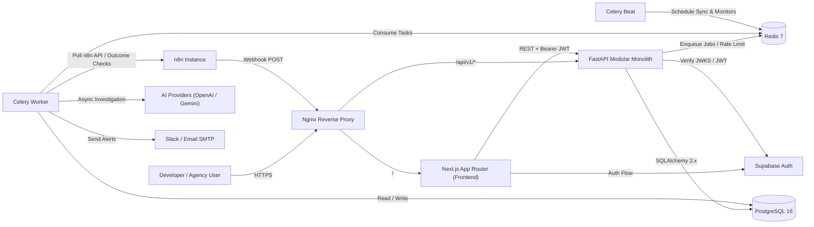

# FlowSentry — System Architecture

**Status:** Phase 0 — Architecture & Planning  
**Architecture Style:** Modular Monolith (Containerized Multi-Service Stack)  
**Date:** 2026-11-22

---

## 1. High-Level Architecture Overview

FlowSentry uses a **modular monolith** architecture to keep development velocity, transactional integrity, and operational simplicity high while preserving clean domain boundaries.



---

## 2. Monorepo Directory Structure

```text
flowsentry/
├── frontend/
│   ├── app/                    # Next.js App Router pages & layouts
│   ├── components/             # Shared UI primitives (shadcn/ui, layout, charts)
│   ├── features/               # Feature modules (incidents, workflows, monitors, integrations)
│   ├── hooks/                  # Custom React & TanStack Query hooks
│   ├── lib/                    # API client, Supabase client, formatters, Zod schemas
│   ├── services/               # Typed API service wrappers
│   ├── types/                  # Shared TypeScript domain interfaces
│   └── tests/                  # Vitest / React Testing Library tests
├── backend/
│   ├── app/
│   │   ├── api/                # FastAPI routers (/api/v1/*), dependencies, rate limiters
│   │   ├── core/               # Config, security, encryption, SSRF guard, logging, billing plans
│   │   ├── models/             # SQLAlchemy 2.x ORM models
│   │   ├── schemas/            # Pydantic v2 request/response & normalized event schemas
│   │   ├── services/           # Auth, workspace, project, quota, audit services
│   │   ├── integrations/       # Provider registry & n8n adapter (API + webhook parser)
│   │   ├── detection/          # Deterministic failure, anomaly, fingerprinting & recovery engine
│   │   ├── intelligence/       # AI provider abstraction (OpenAI, Gemini, deterministic fallback)
│   │   ├── outcomes/           # Outcome monitor evaluators & SSRF-safe HTTP verifier
│   │   ├── incidents/          # Incident lifecycle, notes, assignment & timeline service
│   │   ├── notifications/      # Email, Slack, suppression & delivery tracking
│   │   ├── workers/            # Celery app, polling tasks, detection tasks, AI & monitor tasks
│   │   └── main.py             # FastAPI application entrypoint (/health, /ready, /api/v1)
│   ├── migrations/             # Alembic migration scripts
│   └── tests/                  # Pytest unit, integration, security & E2E tests
├── infrastructure/
│   ├── docker/                 # Dockerfiles for backend & frontend
│   └── nginx/                  # Reverse proxy configuration
├── docs/                       # PRD, Architecture, Database, API, Security, Deployment docs
├── scripts/                    # Seed demo data, key generation, local dev helpers
├── docker-compose.yml
├── .env.example
├── .gitignore
└── README.md
```

---

## 3. Core Subsystem Designs

### 3.1 Authentication & Multi-Tenant Authorization
1. **Frontend Auth:** Uses Supabase Auth (`@supabase/ssr` / `@supabase/supabase-js`) for registration, email verification, sign-in, and password recovery.
2. **Backend JWT Verification (`app/core/security.py`):**
   - Extracts `Authorization: Bearer <token>`.
   - Inspects token header `alg`:
     - **`RS256` / `ES256` (Recommended Supabase JWKS):** Uses `PyJWT`'s `PyJWKClient` fetching `{SUPABASE_URL}/auth/v1/.well-known/jwks.json` with in-memory key caching and automatic `kid` rotation handling.
     - **`HS256` (Legacy Supabase JWT Secret fallback):** Verifies using `SUPABASE_JWT_SECRET` when configured.
   - Validates `aud="authenticated"` and `exp`.
   - Upserts/resolves local `users` row keyed by Supabase `sub` UUID.
   - *Development/Test Mode:* An explicit `AUTH_MODE=local_dev` setting (blocked when `ENVIRONMENT=production`) allows deterministic local JWT signing for automated CI tests without live Supabase network access.
3. **Workspace Isolation & RBAC:**
   - Every workspace-scoped route uses a FastAPI dependency (`require_workspace_role(min_role)`) that resolves `workspace_id` from the path/header/resource, queries `workspace_members` for `(workspace_id, current_user.id)`, and enforces role hierarchy: `owner (4) > admin (3) > member (2) > viewer (1)`.
   - Resource lookup by UUID **always** filters by `workspace_id` so cross-workspace UUID guessing returns `403 Forbidden` or `404 Not Found`.

### 3.2 Integration & Ingestion Pipeline (n8n Primary)

#### Verified n8n Specifications (Researched 2026-11-22)
- **Authentication:** `X-N8N-API-KEY: <api_key>` HTTP request header.
- **Workflows Endpoint:** `GET /api/v1/workflows`
  - Query params: `limit` (default 100, max 250), `cursor`, `active`, `tags`, `name`, `projectId`.
  - Response: `{ "data": [...], "nextCursor": "<string|null>" }`.
- **Executions Endpoint:** `GET /api/v1/executions`
  - Query params: `limit` (default 100, max 250), `cursor`, `status` (`canceled`, `crashed`, `error`, `new`, `running`, `success`, `unknown`, `waiting`), `workflowId`, `projectId`, `startedAfter`, `startedBefore`, `includeData` (`true|false`).
  - Response: `{ "data": [...], "nextCursor": "<string|null>" }`.
  - Note: Executions may contain `redactionInfo` or `dataTooLargeToDisplay: true` depending on instance settings.
- **Error Trigger Webhook Payload:**
  - Triggered by n8n's `Error Trigger` node -> HTTP Request node posting JSON to FlowSentry:
    ```json
    {
      "execution": {
        "id": "231",
        "url": "https://n8n.example.com/execution/231",
        "retryOf": "34",
        "error": { "message": "...", "stack": "..." },
        "lastNodeExecuted": "Node With Error",
        "mode": "webhook"
      },
      "workflow": { "id": "1", "name": "Example Workflow" }
    }
    ```
  - Note: Instant failures prior to execution persistence may omit `execution.id`; our parser handles missing `execution.id` safely by generating a deterministic fallback hash over `(workflow_id, timestamp, error_message, lastNodeExecuted)` or rejecting malformed payloads based on strict schema rules.

#### Ingestion Flow
1. **Webhook Receiver (`POST /api/v1/ingest/webhooks/{integration_id}`):**
   - Validates per-integration webhook secret (`X-FlowSentry-Webhook-Secret` or HMAC signature `X-FlowSentry-Signature-256` compared via `hmac.compare_digest`).
   - Enforces Redis token-bucket rate limiting per integration/IP.
   - Normalizes payload into `NormalizedExecutionEvent (v1.0)` and sanitizes sensitive keys (`authorization`, `cookie`, `password`, `token`, `secret`, `api_key`, `x-n8n-api-key`, bearer patterns).
   - Inserts idempotently using `(workflow_id, external_execution_id)` conflict handling.
   - Enqueues `process_execution_task` in Celery.
2. **Polling Sync (`sync_n8n_integration_task`):**
   - Decrypts `encrypted_credentials` in worker memory only.
   - Validates base URL against SSRF policy before every request.
   - Syncs workflows (`GET /api/v1/workflows`), upserting `workflows` table.
   - Syncs executions since `last_synced_at` / cursor (`GET /api/v1/executions?startedAfter=...`), paginating via `nextCursor`.
   - Updates `integrations.last_synced_at` and `status`.

### 3.3 Deterministic Detection & Fingerprinting Engine (`app/detection/`)
Triggered immediately after execution ingestion:
1. **Status Classification:** Maps provider status (`error`, `crashed` -> `failed`; `success` -> `success`; etc.).
2. **Error Normalization:** Strips volatile tokens (UUIDs, timestamps, request IDs, IP addresses, line numbers) from error messages to compute a stable `error_signature`.
3. **Fingerprinting:**
   `SHA-256(workspace_id + ":" + workflow_id + ":" + error_type + ":" + failed_node + ":" + error_signature)`
4. **Detection Checks:**
   - **Execution Failure:** Status is `failed`.
   - **Performance Anomaly:** `duration_ms > workflow.max_duration_ms` or `> 3x` rolling 20-run p50 duration (when sample count >= 5).
   - **Repeated Failure:** `>= N` failures with same fingerprint inside grouping window (default 24h).
   - **Frequency Anomaly:** Evaluated periodically by Celery Beat against expected cadence.
5. **Incident Grouping:**
   - Looks up an open/acknowledged/investigating/reopened incident matching `(workspace_id, fingerprint)` within the grouping window.
   - If found: increments `occurrence_count`, updates `last_seen_at`, appends `incident_occurrences` row, recalculates severity if escalated.
   - If not found: creates new `incidents` row, creates `incident_occurrences`, triggers notifications (if severity meets threshold) and optional AI investigation task.
6. **Recovery Verification:**
   - On `success` execution for a workflow with open incidents, checks configured `recovery_policy` (default: 3 consecutive successes since `last_seen_at`, and no failing outcome monitors).
   - If satisfied, transitions incident to `resolved`, sets `resolved_at`, and records `resolution_reason = "auto_resolved: 3 consecutive healthy executions verified"`.

### 3.4 AI Investigation Engine (`app/intelligence/`)
- **Interface:** `BaseAIProvider.investigate(evidence: SanitizedEvidence) -> InvestigationResult`
- **Implementations:**
  - `OpenAIProvider` (reads `OPENAI_API_KEY`, `OPENAI_MODEL` from env).
  - `GeminiProvider` (reads `GEMINI_API_KEY`, `GEMINI_MODEL` from env).
  - `DeterministicFallbackAnalyzer` (rule-based analysis for HTTP 401/403/404/429/5xx, timeouts, schema/validation errors, rate limits, missing downstream records — always available offline/without keys).
- **Guardrails:**
  - Strict Pydantic schema validation of AI JSON responses.
  - Prompt explicitly instructs: cite only supplied evidence, distinguish observed facts from hypotheses, never invent execution IDs or logs, never recommend destructive actions.
  - Bounded by workspace monthly AI investigation quota and max token limits.
  - Retries (max 2 with backoff) on transient API errors, then falls back cleanly to `DeterministicFallbackAnalyzer` with status annotation (`completed_fallback`).

### 3.5 Outcome Monitoring Engine (`app/outcomes/`)
Runs via Celery Beat (default every 60s, checking monitors due based on `schedule_seconds`) and on-demand via API (`POST /api/v1/outcome-monitors/{id}/check`):
- **Evaluators:**
  1. `expected_interval`: Queries latest `executions` for `workflow_id`; fails if `now - started_at > max_interval_seconds`.
  2. `expected_count`: Counts executions in `window_seconds`; fails if `< min_count` or `> max_count`.
  3. `required_output_fields`: Inspects latest successful execution's sanitized `normalized_payload` for dot-path keys and non-empty values.
  4. `http_endpoint`: Performs SSRF-guarded HTTP GET/POST to user-configured endpoint; validates expected status code and optional JSON path assertion.
  5. `webhook_confirmation`: Checks whether a confirmation webhook event arrived for the execution within `grace_period_seconds`.
  6. `external_record_check`: Executes configured, read-only API connector verification (e.g., querying a REST endpoint for a created entity ID/filter) under strict SSRF and timeout controls.
- Failures emit `silent_failure` detections into the Incident Engine.

### 3.6 Notifications (`app/notifications/`)
- Channel adapters: `SlackWebhookNotifier`, `SMTPEmailNotifier`.
- **Suppression:** Computes `dedup_key = f"{workspace_id}:{incident_id}:{event_type}:{channel}"` and suppresses duplicate sends within `suppression_window_minutes` (default 30 min) unless severity escalates.
- **Security:** Slack webhook URLs and SMTP passwords are stored encrypted in `notification_preferences` and masked in all API responses (`https://hooks.slack.com/services/...****`).

---

## 4. Security Controls Summary

| Control | Implementation |
|---|---|
| **Secret Encryption** | Fernet / AES-256-GCM using `ENCRYPTION_KEY` from environment |
| **SSRF Protection** | `validate_outbound_url()` resolves DNS, blocks private/loopback/link-local/multicast/reserved IPs (`127.0.0.0/8`, `10.0.0.0/8`, `172.16.0.0/12`, `192.168.0.0/16`, `169.254.0.0/16`, `::1`, `fc00::/7`), enforces `http`/`https` only, disables unsafe redirects |
| **Header & Log Scrubbing** | Middleware & payload sanitizer strip `Authorization`, `X-N8N-API-KEY`, `Cookie`, tokens, passwords |
| **Rate Limiting** | Redis sliding-window limiter on auth, webhook ingestion, and API routes |
| **CORS** | Strict `ALLOWED_ORIGINS` list from env (never `*` with credentials) |
| **Audit Trail** | Immutable `audit_logs` entries for membership changes, integration edits, key creation, and incident state transitions |

---

## 5. Commercial & Billing Readiness

Plans enforced server-side via `app/core/plans.py`:
- **Free (\$0/mo):** 1 workspace, 2 projects, 2 integrations, 1,000 executions/mo, 10 AI investigations/mo, 3 outcome monitors, 1 member.
- **Pro (\$19/mo):** 2 workspaces, 5 projects, 5 integrations, 25,000 executions/mo, 100 AI investigations/mo, 15 outcome monitors, 3 members.
- **Agency (\$59/mo):** 10 workspaces, 25 projects, 25 integrations, 150,000 executions/mo, 500 AI investigations/mo, 75 outcome monitors, 15 members.
- **Business (\$149/mo):** Unlimited workspaces/projects, 100 integrations, 1,000,000 executions/mo, 2,500 AI investigations/mo, 300 outcome monitors, 50 members.

A `BillingProvider` protocol (`NoopBillingProvider` initially) isolates future Stripe webhook/checkout integration without allowing any client-side plan mutations.
