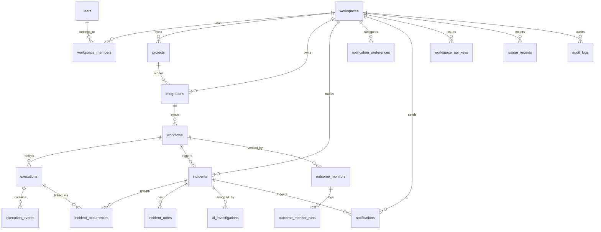

# FlowSentry — Database Design

**Database Engine:** PostgreSQL 16  
**ORM / Migrations:** SQLAlchemy 2.x + Alembic  
**Primary Keys:** UUIDv4 (`uuid.uuid4`)  
**Timestamps:** UTC `TIMESTAMP WITH TIME ZONE` (`TIMESTAMPTZ`)  
**Multi-Tenancy Model:** Strict `workspace_id` ownership and query scoping on all tenant tables.

---

## 1. Entity Relationship Diagram

---

## 2. Table Specifications

### 2.1 `users`
Mirrors authenticated Supabase Auth identities (`id` matches Supabase JWT `sub`).
- `id`: `UUID` PK
- `email`: `VARCHAR(320)` NOT NULL UNIQUE
- `name`: `VARCHAR(255)` NULL
- `avatar_url`: `TEXT` NULL
- `created_at`: `TIMESTAMPTZ` NOT NULL DEFAULT `now()`
- `updated_at`: `TIMESTAMPTZ` NOT NULL DEFAULT `now()`

### 2.2 `workspaces`
Top-level tenant boundary.
- `id`: `UUID` PK
- `name`: `VARCHAR(120)` NOT NULL
- `slug`: `VARCHAR(120)` NOT NULL UNIQUE
- `owner_id`: `UUID` FK -> `users.id` (RESTRICT) NOT NULL
- `plan`: `VARCHAR(32)` NOT NULL DEFAULT `'free'` (`free | pro | agency | business`)
- `is_demo`: `BOOLEAN` NOT NULL DEFAULT `false`
- `settings`: `JSONB` NOT NULL DEFAULT `'{}'` (grouping window, recovery policy, retention days)
- `created_at`: `TIMESTAMPTZ` NOT NULL DEFAULT `now()`
- `updated_at`: `TIMESTAMPTZ` NOT NULL DEFAULT `now()`

### 2.3 `workspace_members`
Role-based membership binding users to workspaces.
- `id`: `UUID` PK
- `workspace_id`: `UUID` FK -> `workspaces.id` (CASCADE) NOT NULL
- `user_id`: `UUID` FK -> `users.id` (CASCADE) NOT NULL
- `role`: `VARCHAR(32)` NOT NULL (`owner | admin | member | viewer`)
- `joined_at`: `TIMESTAMPTZ` NOT NULL DEFAULT `now()`
- **Unique:** `(workspace_id, user_id)`
- **Index:** `idx_workspace_members_user_id (user_id)`

### 2.4 `projects`
Logical grouping and environment segmentation inside a workspace.
- `id`: `UUID` PK
- `workspace_id`: `UUID` FK -> `workspaces.id` (CASCADE) NOT NULL
- `name`: `VARCHAR(120)` NOT NULL
- `description`: `TEXT` NULL
- `environment`: `VARCHAR(32)` NOT NULL DEFAULT `'production'` (`production | staging | development`)
- `created_at`: `TIMESTAMPTZ` NOT NULL DEFAULT `now()`
- `updated_at`: `TIMESTAMPTZ` NOT NULL DEFAULT `now()`
- **Unique:** `(workspace_id, name, environment)`
- **Index:** `idx_projects_workspace_id (workspace_id)`

### 2.5 `integrations`
External automation platform connections (starting with `n8n`).
- `id`: `UUID` PK
- `workspace_id`: `UUID` FK -> `workspaces.id` (CASCADE) NOT NULL
- `project_id`: `UUID` FK -> `projects.id` (CASCADE) NOT NULL
- `provider`: `VARCHAR(32)` NOT NULL (`n8n | custom_webhook`)
- `connection_name`: `VARCHAR(120)` NOT NULL
- `base_url`: `TEXT` NULL
- `encrypted_credentials`: `TEXT` NOT NULL (Fernet/AES-256-GCM encrypted JSON; never returned via API)
- `webhook_secret_hash`: `VARCHAR(128)` NULL (HMAC/SHA-256 hash for incoming error webhook verification)
- `polling_enabled`: `BOOLEAN` NOT NULL DEFAULT `true`
- `polling_interval_seconds`: `INTEGER` NOT NULL DEFAULT `120`
- `sync_cursor`: `TEXT` NULL
- `status`: `VARCHAR(32)` NOT NULL DEFAULT `'pending'` (`pending | connected | error | disconnected`)
- `last_error`: `TEXT` NULL
- `last_connected_at`: `TIMESTAMPTZ` NULL
- `last_synced_at`: `TIMESTAMPTZ` NULL
- `created_at`: `TIMESTAMPTZ` NOT NULL DEFAULT `now()`
- `updated_at`: `TIMESTAMPTZ` NOT NULL DEFAULT `now()`
- **Index:** `idx_integrations_workspace_project (workspace_id, project_id)`

### 2.6 `workflows`
Monitored workflows discovered via integration sync or webhook ingestion.
- `id`: `UUID` PK
- `workspace_id`: `UUID` FK -> `workspaces.id` (CASCADE) NOT NULL
- `project_id`: `UUID` FK -> `projects.id` (CASCADE) NOT NULL
- `integration_id`: `UUID` FK -> `integrations.id` (CASCADE) NOT NULL
- `external_workflow_id`: `VARCHAR(255)` NOT NULL
- `name`: `VARCHAR(255)` NOT NULL
- `description`: `TEXT` NULL
- `enabled`: `BOOLEAN` NOT NULL DEFAULT `true`
- `max_duration_ms`: `INTEGER` NULL (optional SLA threshold)
- `expected_interval_seconds`: `INTEGER` NULL
- `is_demo`: `BOOLEAN` NOT NULL DEFAULT `false`
- `metadata_json`: `JSONB` NOT NULL DEFAULT `'{}'`
- `created_at`: `TIMESTAMPTZ` NOT NULL DEFAULT `now()`
- `updated_at`: `TIMESTAMPTZ` NOT NULL DEFAULT `now()`
- **Unique:** `(integration_id, external_workflow_id)`
- **Index:** `idx_workflows_workspace (workspace_id, enabled)`

### 2.7 `executions`
Normalized workflow execution records.
- `id`: `UUID` PK
- `workspace_id`: `UUID` FK -> `workspaces.id` (CASCADE) NOT NULL
- `workflow_id`: `UUID` FK -> `workflows.id` (CASCADE) NOT NULL
- `external_execution_id`: `VARCHAR(255)` NOT NULL
- `schema_version`: `VARCHAR(16)` NOT NULL DEFAULT `'1.0'`
- `status`: `VARCHAR(32)` NOT NULL (`success | failed | running | waiting | canceled | unknown`)
- `started_at`: `TIMESTAMPTZ` NOT NULL
- `finished_at`: `TIMESTAMPTZ` NULL
- `duration_ms`: `INTEGER` NULL
- `failed_node`: `VARCHAR(255)` NULL
- `error_type`: `VARCHAR(128)` NULL
- `error_summary`: `TEXT` NULL
- `normalized_payload`: `JSONB` NOT NULL DEFAULT `'{}'` (sanitized only)
- `is_demo`: `BOOLEAN` NOT NULL DEFAULT `false`
- `created_at`: `TIMESTAMPTZ` NOT NULL DEFAULT `now()`
- **Unique:** `(workflow_id, external_execution_id)` (guarantees idempotent ingestion)
- **Indexes:**
  - `idx_executions_ws_started (workspace_id, started_at DESC)`
  - `idx_executions_wf_started (workflow_id, started_at DESC)`
  - `idx_executions_ws_status (workspace_id, status)`

### 2.8 `execution_events`
Granular timeline/node events within an execution.
- `id`: `UUID` PK
- `execution_id`: `UUID` FK -> `executions.id` (CASCADE) NOT NULL
- `event_type`: `VARCHAR(64)` NOT NULL
- `node_name`: `VARCHAR(255)` NULL
- `event_timestamp`: `TIMESTAMPTZ` NOT NULL
- `event_payload`: `JSONB` NOT NULL DEFAULT `'{}'` (sanitized)
- **Index:** `idx_execution_events_exec_ts (execution_id, event_timestamp)`

### 2.9 `incidents`
Deduplicated failure or silent-failure groups.
- `id`: `UUID` PK
- `workspace_id`: `UUID` FK -> `workspaces.id` (CASCADE) NOT NULL
- `workflow_id`: `UUID` FK -> `workflows.id` (CASCADE) NOT NULL
- `title`: `VARCHAR(255)` NOT NULL
- `description`: `TEXT` NULL
- `severity`: `VARCHAR(32)` NOT NULL (`critical | high | medium | low | informational`)
- `status`: `VARCHAR(32)` NOT NULL DEFAULT `'open'` (`open | acknowledged | investigating | resolved | reopened`)
- `fingerprint`: `VARCHAR(64)` NOT NULL
- `grouping_window_expires_at`: `TIMESTAMPTZ` NOT NULL
- `first_seen_at`: `TIMESTAMPTZ` NOT NULL
- `last_seen_at`: `TIMESTAMPTZ` NOT NULL
- `occurrence_count`: `INTEGER` NOT NULL DEFAULT `1`
- `assigned_to_user_id`: `UUID` FK -> `users.id` (SET NULL) NULL
- `resolved_at`: `TIMESTAMPTZ` NULL
- `resolution_reason`: `TEXT` NULL
- `resolution_notes`: `TEXT` NULL
- `is_demo`: `BOOLEAN` NOT NULL DEFAULT `false`
- `created_at`: `TIMESTAMPTZ` NOT NULL DEFAULT `now()`
- `updated_at`: `TIMESTAMPTZ` NOT NULL DEFAULT `now()`
- **Indexes:**
  - `idx_incidents_ws_status_last (workspace_id, status, last_seen_at DESC)`
  - `idx_incidents_ws_fingerprint (workspace_id, fingerprint)`
  - `idx_incidents_workflow (workflow_id)`

### 2.10 `incident_occurrences`
Join table linking executions to incidents.
- `id`: `UUID` PK
- `incident_id`: `UUID` FK -> `incidents.id` (CASCADE) NOT NULL
- `execution_id`: `UUID` FK -> `executions.id` (CASCADE) NOT NULL
- `created_at`: `TIMESTAMPTZ` NOT NULL DEFAULT `now()`
- **Unique:** `(incident_id, execution_id)`

### 2.11 `incident_notes`
Internal team investigation notes & lifecycle comments.
- `id`: `UUID` PK
- `incident_id`: `UUID` FK -> `incidents.id` (CASCADE) NOT NULL
- `workspace_id`: `UUID` FK -> `workspaces.id` (CASCADE) NOT NULL
- `author_id`: `UUID` FK -> `users.id` (SET NULL) NULL
- `note_type`: `VARCHAR(32)` NOT NULL DEFAULT `'comment'` (`comment | status_change | system`)
- `content`: `TEXT` NOT NULL
- `created_at`: `TIMESTAMPTZ` NOT NULL DEFAULT `now()`
- **Index:** `idx_incident_notes_incident (incident_id, created_at)`

### 2.12 `ai_investigations`
AI and deterministic root-cause investigations attached to an incident.
- `id`: `UUID` PK
- `incident_id`: `UUID` FK -> `incidents.id` (CASCADE) NOT NULL
- `workspace_id`: `UUID` FK -> `workspaces.id` (CASCADE) NOT NULL
- `provider`: `VARCHAR(32)` NOT NULL (`openai | gemini | deterministic`)
- `model`: `VARCHAR(128)` NOT NULL
- `analysis_status`: `VARCHAR(32)` NOT NULL (`queued | running | completed | completed_fallback | failed`)
- `summary`: `TEXT` NULL
- `root_cause_hypothesis`: `TEXT` NULL
- `confidence`: `NUMERIC(4,3)` NULL
- `evidence`: `JSONB` NOT NULL DEFAULT `'[]'`
- `possible_causes`: `JSONB` NOT NULL DEFAULT `'[]'`
- `recommended_actions`: `JSONB` NOT NULL DEFAULT `'[]'`
- `severity_assessment`: `VARCHAR(32)` NULL
- `requires_human_review`: `BOOLEAN` NOT NULL DEFAULT `true`
- `token_usage`: `JSONB` NOT NULL DEFAULT `'{}'`
- `error_message`: `TEXT` NULL
- `created_at`: `TIMESTAMPTZ` NOT NULL DEFAULT `now()`
- `completed_at`: `TIMESTAMPTZ` NULL
- **Index:** `idx_ai_investigations_incident (incident_id, created_at DESC)`

### 2.13 `outcome_monitors`
User-configured business outcome & silent failure checks.
- `id`: `UUID` PK
- `workspace_id`: `UUID` FK -> `workspaces.id` (CASCADE) NOT NULL
- `workflow_id`: `UUID` FK -> `workflows.id` (CASCADE) NOT NULL
- `name`: `VARCHAR(150)` NOT NULL
- `description`: `TEXT` NULL
- `monitor_type`: `VARCHAR(64)` NOT NULL (`expected_interval | expected_count | required_output_fields | http_endpoint | webhook_confirmation | external_record_check`)
- `configuration`: `JSONB` NOT NULL DEFAULT `'{}'`
- `expected_result`: `JSONB` NOT NULL DEFAULT `'{}'`
- `schedule_seconds`: `INTEGER` NOT NULL DEFAULT `300`
- `severity`: `VARCHAR(32)` NOT NULL DEFAULT `'high'`
- `enabled`: `BOOLEAN` NOT NULL DEFAULT `true`
- `status`: `VARCHAR(32)` NOT NULL DEFAULT `'unknown'` (`healthy | failing | unknown`)
- `last_checked_at`: `TIMESTAMPTZ` NULL
- `last_success_at`: `TIMESTAMPTZ` NULL
- `last_failure_at`: `TIMESTAMPTZ` NULL
- `failure_evidence`: `JSONB` NULL
- `is_demo`: `BOOLEAN` NOT NULL DEFAULT `false`
- `created_at`: `TIMESTAMPTZ` NOT NULL DEFAULT `now()`
- `updated_at`: `TIMESTAMPTZ` NOT NULL DEFAULT `now()`
- **Index:** `idx_outcome_monitors_ws_enabled (workspace_id, enabled)`

### 2.14 `outcome_monitor_runs`
Execution history for outcome monitor checks.
- `id`: `UUID` PK
- `monitor_id`: `UUID` FK -> `outcome_monitors.id` (CASCADE) NOT NULL
- `workspace_id`: `UUID` FK -> `workspaces.id` (CASCADE) NOT NULL
- `passed`: `BOOLEAN` NOT NULL
- `evidence`: `JSONB` NOT NULL DEFAULT `'{}'`
- `duration_ms`: `INTEGER` NULL
- `checked_at`: `TIMESTAMPTZ` NOT NULL DEFAULT `now()`
- **Index:** `idx_monitor_runs_monitor_ts (monitor_id, checked_at DESC)`

### 2.15 `notification_preferences`
Per-workspace notification channels & filtering rules.
- `id`: `UUID` PK
- `workspace_id`: `UUID` FK -> `workspaces.id` (CASCADE) NOT NULL
- `channel`: `VARCHAR(32)` NOT NULL (`email | slack`)
- `enabled`: `BOOLEAN` NOT NULL DEFAULT `false`
- `encrypted_config`: `TEXT` NOT NULL (encrypted Slack webhook URL or email recipient list/SMTP override)
- `events`: `JSONB` NOT NULL DEFAULT `'["critical_incident","high_incident","outcome_failure"]'`
- `min_severity`: `VARCHAR(32)` NOT NULL DEFAULT `'high'`
- `suppression_minutes`: `INTEGER` NOT NULL DEFAULT `30`
- `created_at`: `TIMESTAMPTZ` NOT NULL DEFAULT `now()`
- `updated_at`: `TIMESTAMPTZ` NOT NULL DEFAULT `now()`
- **Unique:** `(workspace_id, channel)`

### 2.16 `notifications`
Delivery ledger and retry tracking.
- `id`: `UUID` PK
- `workspace_id`: `UUID` FK -> `workspaces.id` (CASCADE) NOT NULL
- `incident_id`: `UUID` FK -> `incidents.id` (SET NULL) NULL
- `channel`: `VARCHAR(32)` NOT NULL (`email | slack`)
- `event_type`: `VARCHAR(64)` NOT NULL
- `dedup_key`: `VARCHAR(255)` NOT NULL
- `status`: `VARCHAR(32)` NOT NULL (`pending | sent | suppressed | failed`)
- `attempt_count`: `INTEGER` NOT NULL DEFAULT `0`
- `error_message`: `TEXT` NULL
- `sent_at`: `TIMESTAMPTZ` NULL
- `created_at`: `TIMESTAMPTZ` NOT NULL DEFAULT `now()`
- **Index:** `idx_notifications_ws_created (workspace_id, created_at DESC)`
- **Index:** `idx_notifications_dedup (dedup_key, created_at DESC)`

### 2.17 `workspace_api_keys`
Scoped API keys for ingestion webhooks or external CLI tools.
- `id`: `UUID` PK
- `workspace_id`: `UUID` FK -> `workspaces.id` (CASCADE) NOT NULL
- `created_by_user_id`: `UUID` FK -> `users.id` (SET NULL) NULL
- `name`: `VARCHAR(120)` NOT NULL
- `key_prefix`: `VARCHAR(16)` NOT NULL
- `key_hash`: `VARCHAR(128)` NOT NULL UNIQUE
- `scopes`: `JSONB` NOT NULL DEFAULT `'["ingest:write"]'`
- `last_used_at`: `TIMESTAMPTZ` NULL
- `revoked_at`: `TIMESTAMPTZ` NULL
- `created_at`: `TIMESTAMPTZ` NOT NULL DEFAULT `now()`

### 2.18 `usage_records`
Monthly usage metering for plan enforcement and billing readiness.
- `id`: `UUID` PK
- `workspace_id`: `UUID` FK -> `workspaces.id` (CASCADE) NOT NULL
- `period_month`: `VARCHAR(7)` NOT NULL (`YYYY-MM`)
- `executions_count`: `INTEGER` NOT NULL DEFAULT `0`
- `ai_investigations_count`: `INTEGER` NOT NULL DEFAULT `0`
- `ai_tokens_used`: `INTEGER` NOT NULL DEFAULT `0`
- `updated_at`: `TIMESTAMPTZ` NOT NULL DEFAULT `now()`
- **Unique:** `(workspace_id, period_month)`

### 2.19 `audit_logs`
Immutable audit log for security and compliance tracking.
- `id`: `UUID` PK
- `workspace_id`: `UUID` FK -> `workspaces.id` (CASCADE) NOT NULL
- `user_id`: `UUID` FK -> `users.id` (SET NULL) NULL
- `action`: `VARCHAR(128)` NOT NULL
- `resource_type`: `VARCHAR(64)` NOT NULL
- `resource_id`: `VARCHAR(128)` NULL
- `metadata_json`: `JSONB` NOT NULL DEFAULT `'{}'`
- `created_at`: `TIMESTAMPTZ` NOT NULL DEFAULT `now()`
- **Index:** `idx_audit_logs_ws_created (workspace_id, created_at DESC)`

---

## 3. Data Isolation & Retention Rules

1. **Production vs. Demo Isolation:** Demo data lives exclusively inside workspaces marked `is_demo = true` (and rows flagged `is_demo = true`). Production dashboard queries never aggregate `is_demo = true` rows.
2. **Retention Policy:** Configurable workspace retention (default: 30 days on Free, 90 days on Pro, 180 days on Agency, 365 days on Business) enforced by a scheduled Celery cleanup task pruning expired `executions`, `execution_events`, and `outcome_monitor_runs`.
3. **Credential Scrubbing on Disconnect:** Disconnecting an integration clears `encrypted_credentials` and `webhook_secret_hash` immediately while preserving historical incident auditability unless explicitly deleted.
